# MANUAL TÉCNICO — Proyecto 1

## Portada / Identificación del proyecto

| Campo | Valor |
|---|---|
| **Proyecto** | Desarrollo, Conexión y Gestión de Contenedores en Entornos Virtualizados |
| **Repositorio** | `202300476_LAB_SO1_2S2026` (privado, GitHub) |
| **Carnet** | **202300476** |
| **Curso** | Sistemas Operativos 1 — 2do Semestre 2026 |
| **Universidad** | Universidad de San Carlos de Guatemala — Facultad de Ingeniería |
| **Ponderación** | 15 pts |

---

## 1. Descripción del proyecto

Se implementa un entorno virtualizado (KVM) con 3 máquinas virtuales Linux. En ellas se
despliegan **3 APIs REST en Go** empaquetadas en contenedores, un **registro privado de
imágenes (Zot)** y **comunicación cruzada** entre servicios mediante REST/HTTP con JSON.
Cada VM usa un runtime de contenedores distinto, tal como exige el enunciado.

---

## 2. Arquitectura

| Máquina Virtual | Runtime | Contenedores |
|---|---|---|
| VM1 | Containerd | API1, API2 |
| VM2 | Podman | API3 |
| VM3 | Docker | Zot Registry |

### 2.1 Diagrama de arquitectura

```
              HOST (KVM / qemu-kvm · Fedora 42)
              Red NAT "lab-so1" (virbr1, 192.168.100.0/24)
                      │
        ┌─────────────┼─────────────┐
        │             │             │
      VM1           VM2           VM3
  so1-vm1        so1-vm2        so1-vm3
  192.168.100.10 192.168.100.20 192.168.100.30
   Containerd      Podman         Docker
        │             │             │
    API1, API2      API3        Zot Registry
    :8081,:8082     :8083        :5000
```

### 2.2 Red

- Red libvirt: **`lab-so1`** (NAT), bridge `virbr1`, subred `192.168.100.0/24`.
- Gateway/DNS de las VMs: `192.168.100.1` (el host hace NAT).
- Las VMs se comunican entre sí y acceden a Internet a través del host.

---

## 3. Flujo de comunicación

1. El usuario llama a un endpoint de una API (p. ej. `GET /api1/202300476/call-api2`).
2. API1 ejecuta una petición **HTTP real** al `/health` de la API destino.
3. La API destino responde su `/health`.
4. API1 analiza el campo `status`: si es `"UP"`, el destino está operativo.
5. API1 responde con `connection:true` (o `connection:false` + `ERROR` si falló).

```
Usuario ──▶ API1 ──HTTP──▶ API2 (/health) ──► respuesta ──▶ análisis "UP" ──▶ respuesta JSON
```

---

## 4. Máquinas virtuales

| VM | Hostname | IP | Sistema | vCPU | RAM | Disco |
|---|---|---|---|---|---|---|
| SO1-VM1 | so1-vm1 | 192.168.100.10 | Debian 12 | 2 | 1024 MB | 12 GB (qcow2) |
| SO1-VM2 | so1-vm2 | 192.168.100.20 | Debian 12 | 1 | 768 MB | 12 GB (qcow2) |
| SO1-VM3 | so1-vm3 | 192.168.100.30 | Debian 12 | 2 | 1024 MB | 12 GB (qcow2) |

- Acceso SSH: `ssh root@<IP>` · clave pública del host (la contraseña de acceso a las VMs
  no se documenta en el repositorio).
- Creadas con **KVM/libvirt** sobre `qemu-kvm`. Gestión con `virt-manager` y `virsh`.

---

## 5. APIs (Go)

Cada API es un módulo Go independiente (`api1/`, `api2/`, `api3/`), compilada como
binario estático y ejecutada como contenedor.

| API | Módulo | Puerto | VM | Llama a |
|---|---|---|---|---|
| API1 | `github.com/202300476/api1` | 8081 | VM1 | API2, API3 |
| API2 | `github.com/202300476/api2` | 8082 | VM1 | API1, API3 |
| API3 | `github.com/202300476/api3` | 8083 | VM2 | API1, API2 |

### 5.1 Endpoints

| API | `/health` | Endpoint 1 | Endpoint 2 |
|---|---|---|---|
| API1 | `/health` | `/api1/202300476/call-api2` | `/api1/202300476/call-api3` |
| API2 | `/health` | `/api2/202300476/call-api1` | `/api2/202300476/call-api3` |
| API3 | `/health` | `/api3/202300476/call-api1` | `/api3/202300476/call-api2` |

### 5.2 Formato JSON — `/health`

```json
{
  "status": "UP",
  "message": "API1 is Ready",
  "timestamp": "2026-08-21T06:07:18Z",
  "VM": "VM1",
  "carnet": "202300476"
}
```

### 5.3 Formato JSON — endpoint de llamada (éxito / error)

Éxito:
```json
{"apiname":"API2","message":"The API2 located on the VM1 is working","connection":true,"carnet":"202300476"}
```
Error:
```json
{"apiname":"API2","message":"ERROR: The API2 located on the VM1 is not working","connection":false,"carnet":"202300476"}
```

### 5.4 Variables de entorno

| Variable | Función |
|---|---|
| `PORT` | Puerto de escucha (default 8081/8082/8083) |
| `TARGET_API1` | URL `/health` de API1 (lo usan API2 y API3) |
| `TARGET_API2` | URL `/health` de API2 (lo usan API1 y API3) |
| `TARGET_API3` | URL `/health` de API3 (lo usan API1 y API2) |

Valores reales desplegados:

| API | TARGET_API1 | TARGET_API2 | TARGET_API3 |
|---|---|---|---|
| API1 | — | `http://192.168.100.10:8082/health` | `http://192.168.100.20:8083/health` |
| API2 | `http://192.168.100.10:8081/health` | — | `http://192.168.100.20:8083/health` |
| API3 | `http://192.168.100.10:8081/health` | `http://192.168.100.10:8082/health` | — |

---

## 6. Runtimes de contenedores

### 6.1 Containerd (VM1)

- Versión: **ctr 1.6.20**.
- Sirve a API1 y API2 (namespace `default`).
- Docker **no instalado** en VM1.
- Verificación: `sudo ctr namespace ls`, `sudo systemctl status containerd`.

### 6.2 Podman (VM2)

- Versión: **4.3.1**.
- Sirve a API3.
- Docker **no instalado** en VM2.
- Verificación: `podman info`, `podman -v`.

### 6.3 Docker (VM3)

- Versión: **20.10.24+dfsg1** (storage driver overlay2).
- Ejecuta únicamente el contenedor **Zot**. Ninguna API corre en VM3.
- Verificación: `docker info`, `docker -v`.

---

## 7. Zot Registry

- Imagen: `ghcr.io/project-zot/zot:latest`.
- Configuración: `/opt/zot/config.yaml` (storage `/var/lib/registry`, HTTP `0.0.0.0:5000`).
- Datos persistidos en `/opt/zot/data`.
- Accesible en `http://192.168.100.30:5000`.
- Catálogo:
  ```bash
  curl http://192.168.100.30:5000/v2/_catalog
  # {"repositories":["api1-202300476","api2-202300476","api3-202300476"]}
  ```

### 7.1 Flujo push/pull

- **Push de API1/API2** desde VM1 (Containerd):
  ```bash
  ctr -n default images tag docker.io/library/api1-202300476:1.0 192.168.100.30:5000/api1-202300476:1.0
  ctr -n default images push --plain-http 192.168.100.30:5000/api1-202300476:1.0
  ```
- **Push de API3** desde VM2 (Podman):
  ```bash
  podman tag api3-202300476:1.0 192.168.100.30:5000/api3-202300476:1.0
  podman push --tls-verify=false 192.168.100.30:5000/api3-202300476:1.0
  ```
- **Pull cruzado** con cada runtime:
  ```bash
  # VM2 (podman) descarga API1
  podman pull --tls-verify=false 192.168.100.30:5000/api1-202300476:1.0
  # VM1 (containerd) descarga API3
  ctr -n default images pull --plain-http 192.168.100.30:5000/api3-202300476:1.0
  ```

> Zot se expone por HTTP; para push/pull se usan `--plain-http` (ctr) y
> `--tls-verify=false` (podman), acotados por comando (no se desactiva seguridad global).

### 7.2 Imágenes

| Nombre canónico | Imagen real (tag 1.0) | Runtime |
|---|---|---|
| API1-202300476 | `api1-202300476` | Containerd (VM1) |
| API2-202300476 | `api2-202300476` | Containerd (VM1) |
| API3-202300476 | `api3-202300476` | Podman (VM2) |

---

## 8. Comunicación cruzada

Los 6 endpoints de llamada realizan una petición HTTP real al `/health` del destino y
responden `connection:true` si `status == "UP"`, o `connection:false` en caso de error.

### 8.1 Manejo de errores

- Si la API destino está caída, no responde, devuelve JSON inválido o `status != "UP"`, la
  API que llama responde `connection:false` con mensaje `ERROR: ... is not working`.
- Se usa un cliente HTTP con timeout de **5 s** para no dejar la petición colgada.
- La API que llama **no se cae**: siempre responde HTTP 200 con el resultado.

---

## 9. Pruebas realizadas y resultados

### 9.1 `/health`

| API | Endpoint | Resultado |
|---|---|---|
| API1 | `curl -s http://192.168.100.10:8081/health \| jq .` | ✅ `status:UP` · `VM:VM1` · `carnet:202300476` |
| API2 | `curl -s http://192.168.100.10:8082/health \| jq .` | ✅ `status:UP` · `VM:VM1` · `carnet:202300476` |
| API3 | `curl -s http://192.168.100.20:8083/health \| jq .` | ✅ `status:UP` · `VM:VM2` · `carnet:202300476` |

### 9.2 Seis endpoints de llamada

| Endpoint | HTTP | connection |
|---|---|---|
| `GET /api1/202300476/call-api2` | 200 | ✅ true |
| `GET /api1/202300476/call-api3` | 200 | ✅ true |
| `GET /api2/202300476/call-api1` | 200 | ✅ true |
| `GET /api2/202300476/call-api3` | 200 | ✅ true |
| `GET /api3/202300476/call-api1` | 200 | ✅ true |
| `GET /api3/202300476/call-api2` | 200 | ✅ true |

### 9.3 Prueba de error (detener/levantar API3)

- API3 detenida → API1→API3 y API2→API3 responden `connection:false` + `ERROR`. ✅
- API3 levantada → `connection:true` de nuevo. ✅
- API3 quedó en ejecución al final. ✅

### 9.4 Registro Zot

- `curl http://192.168.100.30:5000/v2/_catalog`
  → `{"repositories":["api1-202300476","api2-202300476","api3-202300476"]}` ✅
- Push desde VM1 (API1, API2) y VM2 (API3) → OK. Pull cruzado (podman/ctr) → OK. ✅

### 9.5 Verificación de guía (resumen)

| VM | Contenedores | Resultado |
|---|---|---|
| VM1 | `sudo ctr -n default containers ls` → api1, api2 | ✅ RUNNING |
| VM2 | `podman ps` → api3 | ✅ Up |
| VM3 | `docker ps` → solo zot | ✅ Up |

### 9.6 Evidencias visuales

#### Entorno virtualizado

Virtual Machine Manager con las tres VMs en ejecución:

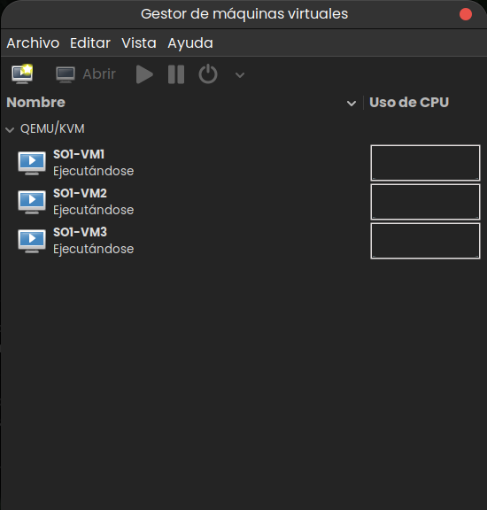

Listado de las máquinas virtuales administradas por libvirt/KVM:

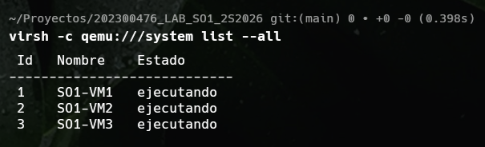

#### Runtimes de contenedores

Containerd activo en VM1:

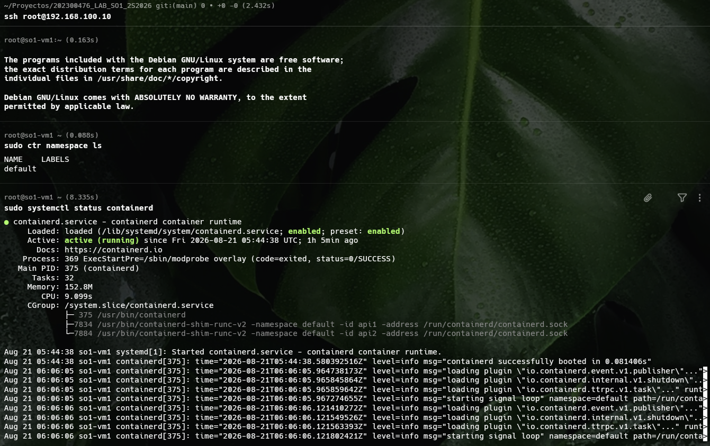

Podman instalado en VM2:

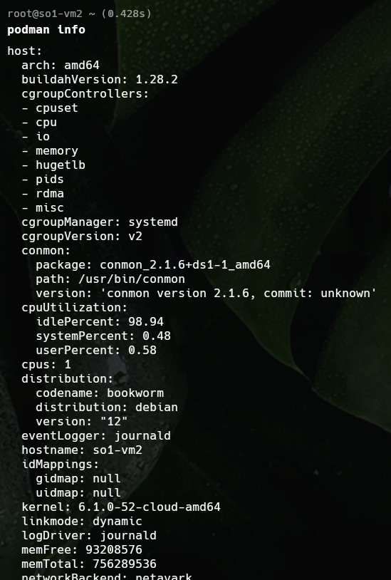

Docker instalado en VM3:

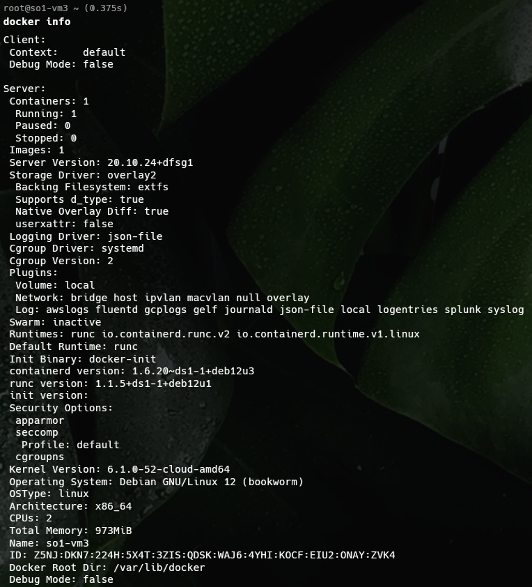

#### Contenedores, imágenes y salud de las APIs

Contenedores e imágenes administrados por Containerd en VM1:

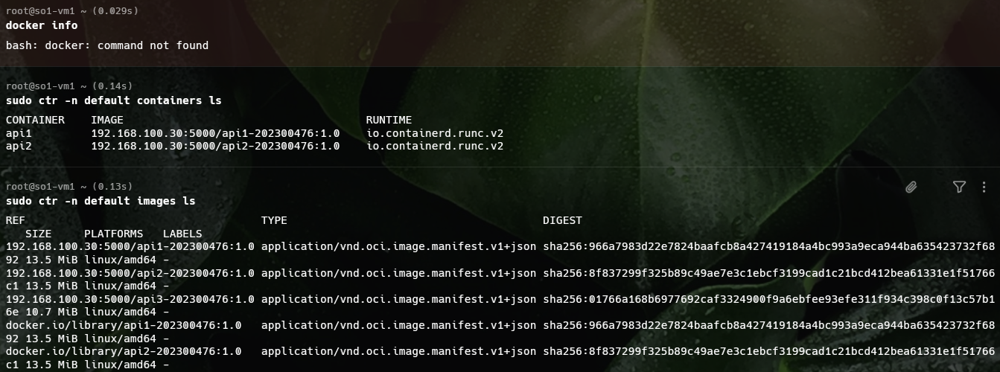

Contenedor e imágenes administrados por Podman en VM2:

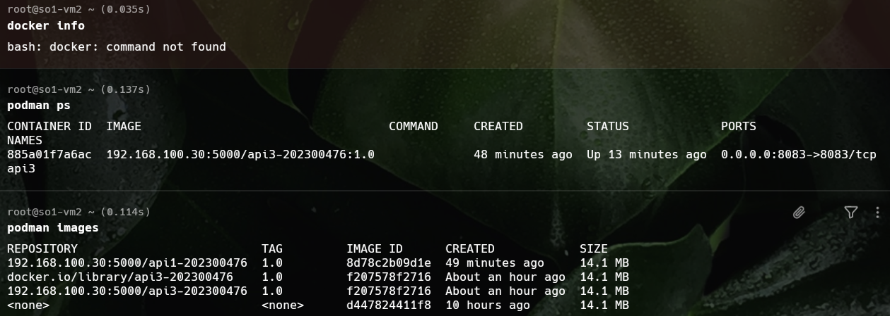

Contenedor Zot e imagen administrados por Docker en VM3:

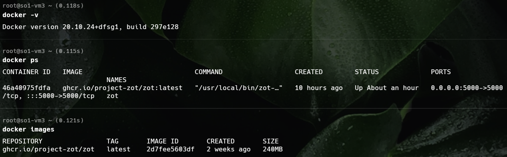

Respuesta del endpoint `/health` de API1:


Respuesta del endpoint `/health` de API2:

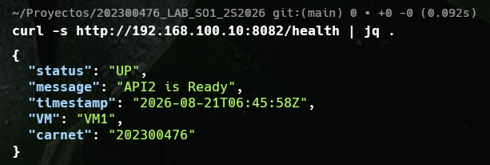

Respuesta del endpoint `/health` de API3:

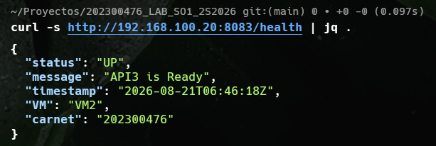

#### Registro privado Zot

Catálogo con las imágenes de las tres APIs:

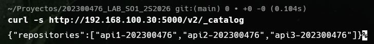

#### Comunicación cruzada

Resultado exitoso de los seis endpoints de comunicación entre APIs:

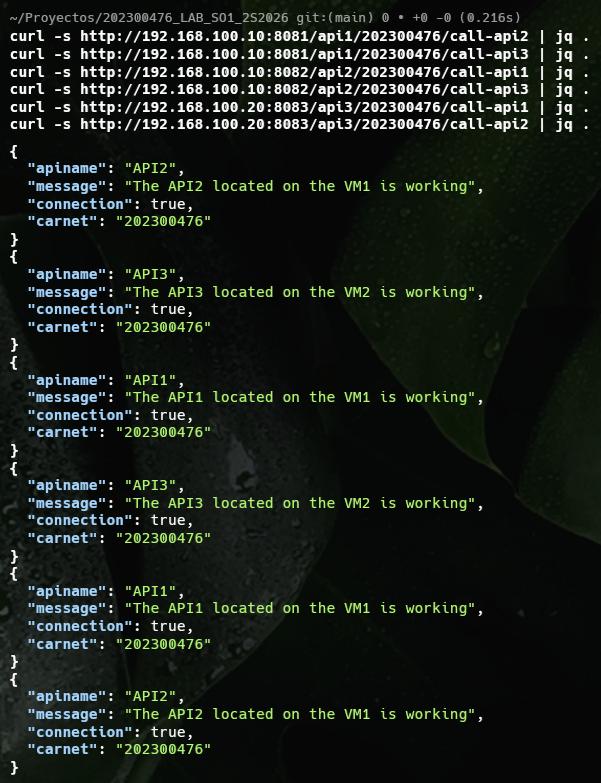

---

## 10. Scripts de validación

- `scripts/validation/validate-registry.sh` — valida Zot (catálogo + pull opcional).
- `scripts/validation/test-all.sh` — valida `/health`, 6 endpoints y (opcional) prueba de error.
