# Evidencias de funcionamiento — Proyecto 2

Las siguientes capturas corresponden a ejecuciones reales del proyecto en
Fedora Linux con kernel `6.19.14-108.fc42.x86_64`. Demuestran la compilación y
el ciclo de vida del módulo, la ejecución del daemon, la generación de carga,
la captura de señales mediante eBPF, la persistencia en Valkey y la
visualización en Grafana.

## Módulo de kernel

### Compilación

El módulo `continfo.ko` se compiló contra los headers del kernel en ejecución.

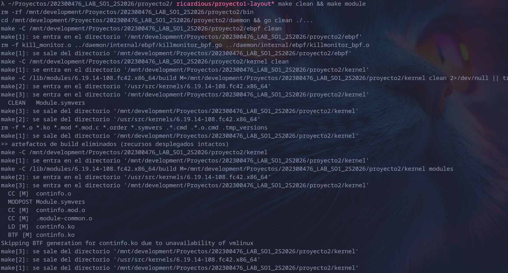

### Carga e interfaz `/proc`

Después de cargar el módulo aparece
`/proc/continfo_pr2_so1_202300476` y `lsmod` confirma que `continfo` está activo.

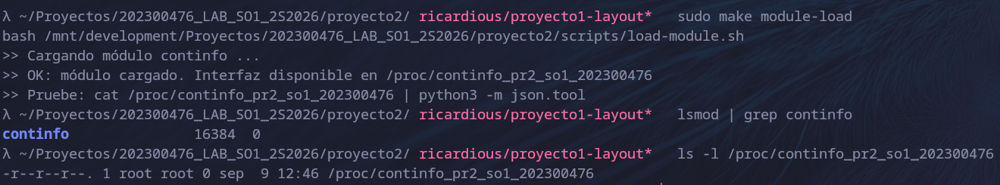

La interfaz entrega un documento JSON con memoria del sistema y datos de los
procesos.

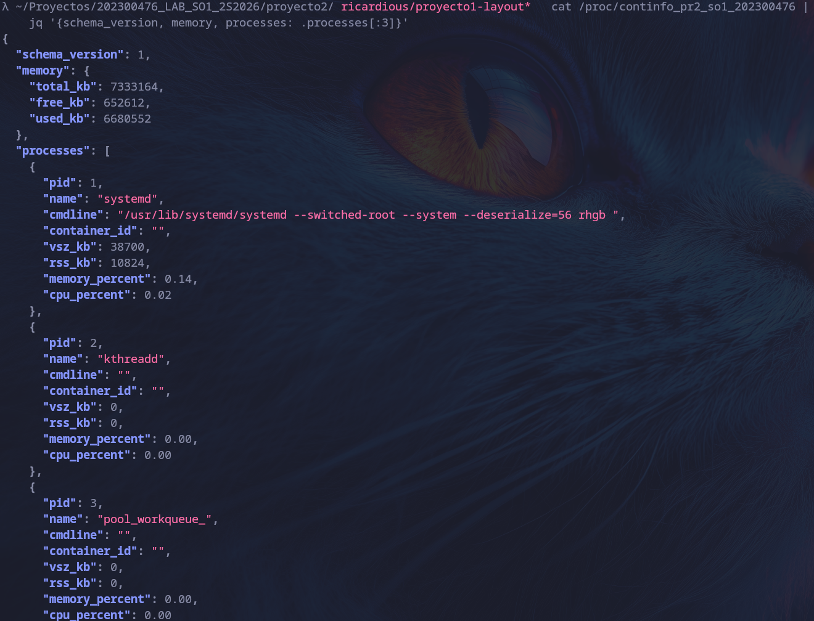

Los mensajes del kernel registran las operaciones de carga y descarga.

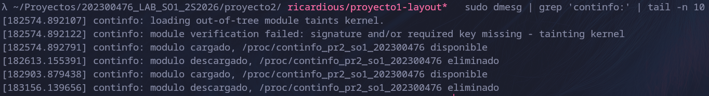

Finalmente, la descarga elimina tanto el módulo como su archivo en `/proc`.

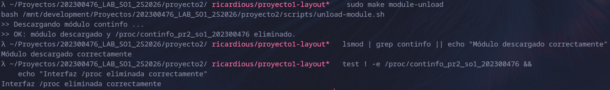

## Daemon y política de contenedores

El daemon inicia con el módulo disponible y mantiene activo el consumidor
eBPF.

La política reduce los contenedores gestionados y conserva los mínimos de tres
perfiles de bajo consumo y dos de alto consumo. Grafana y Valkey permanecen
protegidos.

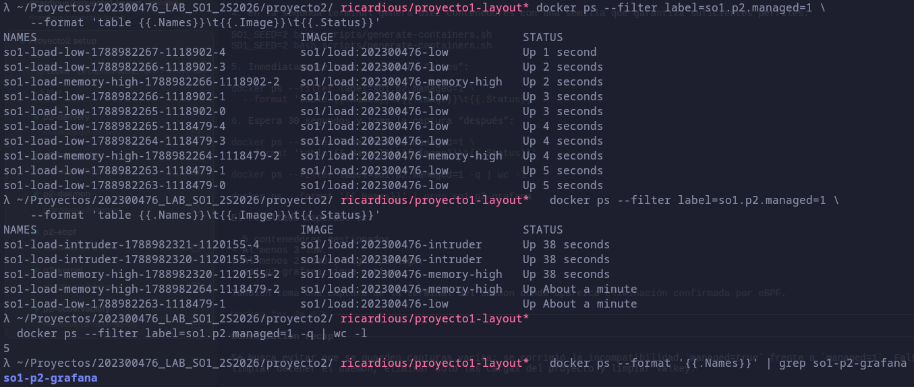

Detalle de la ejecución: [política y contenedores](daemon-politica/politica.txt).

## Cron y generación de carga

El cronjob de `root` ejecuta el generador cada dos minutos.

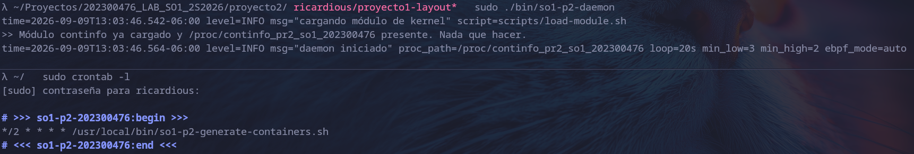

Dos ejecuciones consecutivas generan diez contenedores con perfiles y límites
de recursos distintos.

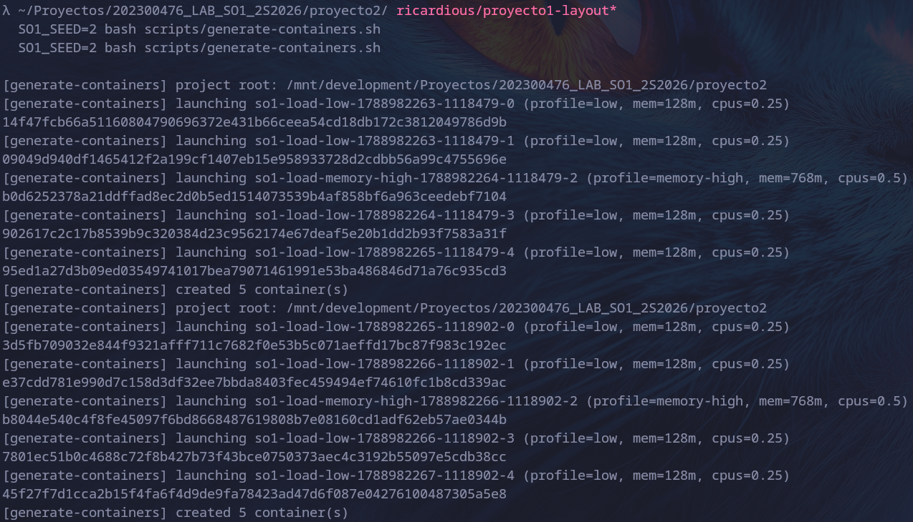

Detalle de la instalación: [cron y cargas](cron-workloads/cron.txt).

## Observabilidad eBPF

El objeto eBPF y el daemon se compilan correctamente.

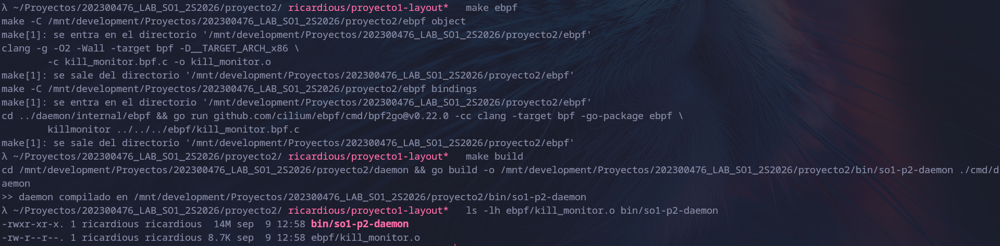

La prueba privilegiada adjunta los tracepoints y recibe el evento real de
`kill(2)`.

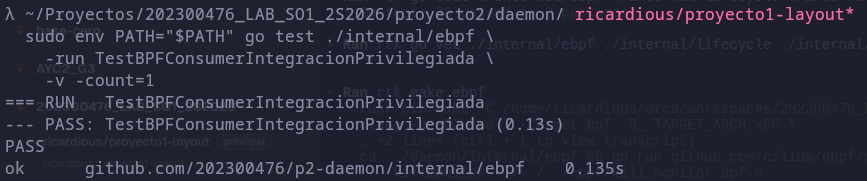

Los eventos confirmados incrementan el contador y el stream de Valkey con PID,
señal, timestamp e identificador de contenedor.

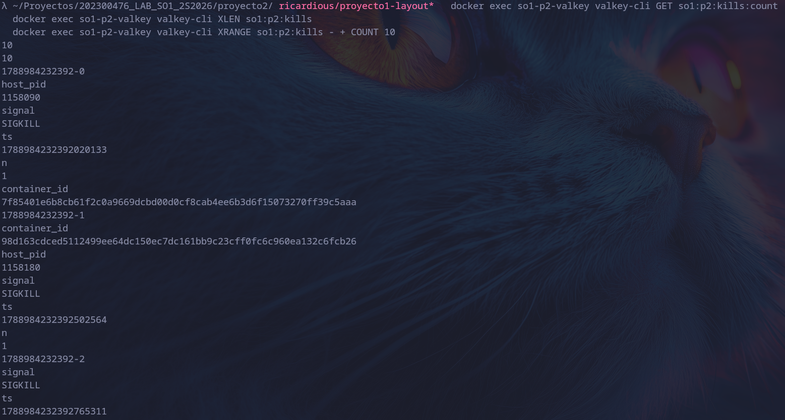

Datos completos: [eventos eBPF](ebpf/ebpf.txt).

## Valkey y Grafana

Valkey y Grafana se ejecutan como contenedores saludables.

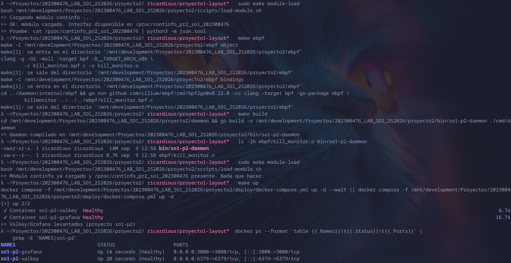

Las claves `so1:p2:*` contienen telemetría del sistema, timelines, rankings y
el historial de eliminaciones.

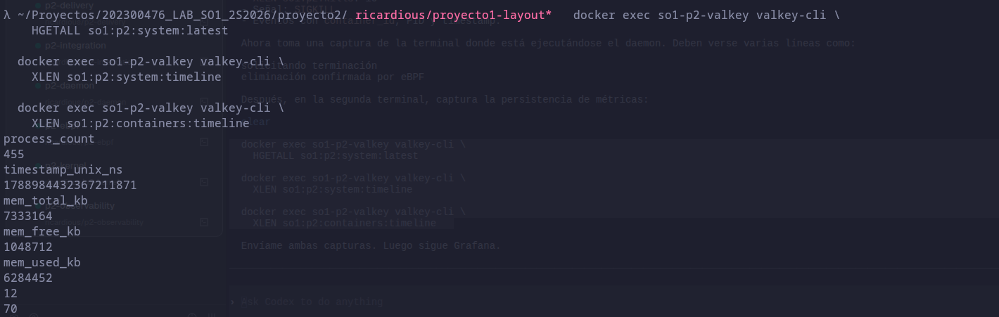

### Kernel Operations Center

La vista general presenta capacidad de memoria, RAM usada y disponible,
procesos observados, presión de memoria y eliminaciones confirmadas.

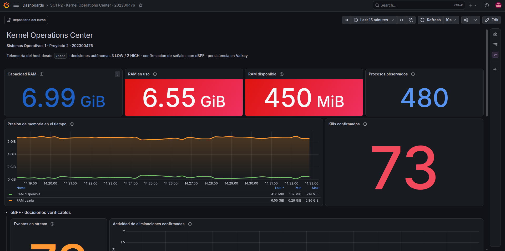

La sección eBPF muestra el contador, la actividad en el tiempo y la bitácora de
señales confirmadas.

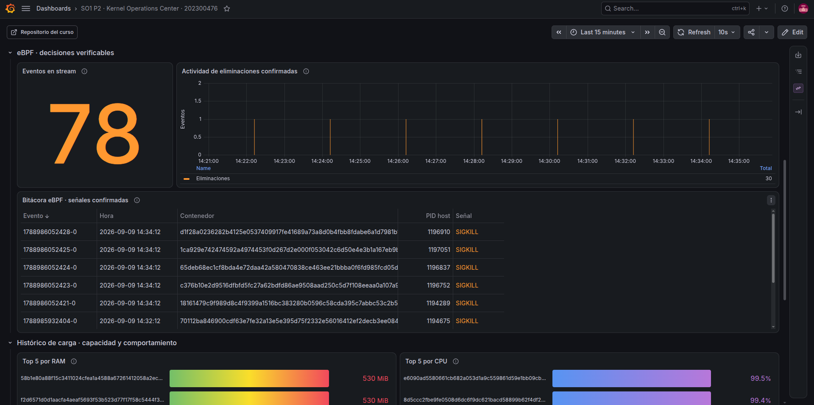

El dashboard completa la observabilidad con rankings históricos de RAM y CPU,
además del timeline de contenedores activos e inactivos.

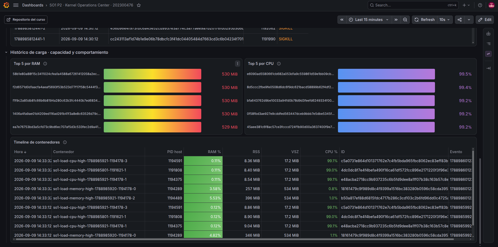

Datos completos: [telemetría de Valkey y salud de Grafana](valkey-grafana/observabilidad.txt).

## Entorno de prueba

Las versiones de las herramientas, los headers del kernel y la disponibilidad
de BTF están documentados en [entorno.txt](entorno/entorno.txt).
