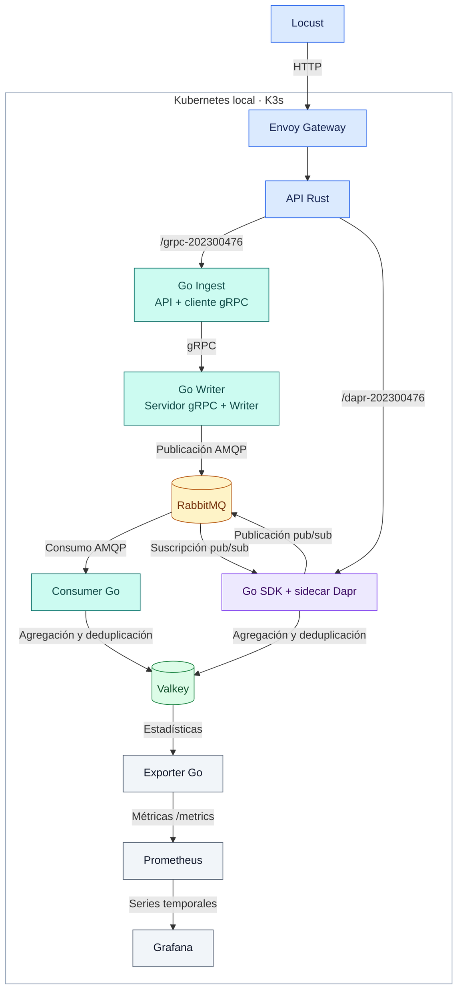

# Proyecto 3 · M.U.M.N.K8s

Sistema distribuido para la recepción, procesamiento y visualización de reportes militares simulados. Desarrollado para el laboratorio de Sistemas Operativos 1, segundo semestre de 2026.

**Carnet:** 202300476 · **País asignado:** España (`ESP`)

La aplicación recibe reportes de cinco países, procesa los eventos mediante RabbitMQ y almacena estadísticas en Valkey. Grafana presenta los indicadores a través de Prometheus. El despliegue utiliza Kubernetes local y un operador basado en Helm para administrar Valkey y Grafana.

## Arquitectura



Los colores identifican entrada HTTP (azul), servicios Go (turquesa), mensajería (ámbar), almacenamiento (verde), Dapr (violeta) y observabilidad (gris). El exporter se ejecuta dentro del Consumer Go.

El sistema dispone de dos rutas públicas, expuestas mediante Envoy Gateway:

| Ruta | Procesamiento |
|---|---|
| `POST /grpc-202300476` | Rust → API Go → cliente gRPC → servidor gRPC → Writer → RabbitMQ → Consumer → Valkey |
| `POST /dapr-202300476` | Rust → publicador Go SDK → Dapr → RabbitMQ → suscriptor Go SDK → Valkey |

Ambos flujos comparten la validación de entrada, la deduplicación por identificador y las estadísticas almacenadas. La respuesta `202 Accepted` indica que el broker confirmó la publicación; el almacenamiento y la actualización del dashboard son asíncronos.

| Componente | Función |
|---|---|
| Locust | Generación de reportes y pruebas de carga para ambas rutas. |
| Envoy Gateway | Exposición HTTP mediante los recursos `Gateway` y `HTTPRoute`. |
| API Rust | Validación de reportes y envío al flujo seleccionado. |
| Servicios Go | Comunicación gRPC, publicación, consumo y agregación de eventos. |
| RabbitMQ | Mensajería persistente entre productores y consumidores. |
| Valkey | Estadísticas, rankings, historial y claves de deduplicación. |
| Helm Operator | Administración de `ValkeyInstance` y `GrafanaInstance`. |
| Prometheus y Grafana | Recolección de métricas y visualización de indicadores. |
| Zot | Registro HTTPS de imágenes y del perfil de carga como artefacto OCI. |
| Falco | Detección de lecturas del archivo de prueba mediante eBPF. |
| Dapr | Flujo adicional de publicación y suscripción sobre RabbitMQ. |

La infraestructura consta de un nodo K3s administrado con k3d sobre Docker. Zot y Locust se ejecutan en el host. Podman construye las imágenes con un almacén independiente; los datos y las cachés se ubican fuera del repositorio mediante `SO1_P3_DATA`.

## Instalación

Los requisitos del equipo, las dependencias y la configuración del entorno se describen en la [guía de instalación](docs/GUIA_INSTALACION.md).

```bash
cd proyecto3
cp .env.example .env
make setup
```

`make setup` ejecuta las siguientes etapas de forma secuencial:

| Etapa | Comando | Resultado |
|---|---|---|
| Preparación | `make bootstrap` | Herramientas, certificados, registro Zot y clúster local. |
| Generador de carga | `make setup-load` | Entorno virtual de Python con Locust. |
| Imágenes externas | `make mirror` | Imágenes de dependencias publicadas en Zot en formato OCI. |
| Compilación | `make build` | Binarios e imágenes de los servicios del proyecto. |
| Despliegue | `make up` | Servicios, operador, Gateway API, Dapr, Falco y accesos locales. |

La configuración de puertos y almacenamiento se encuentra en [.env.example](.env.example). Los nombres de clúster y namespace utilizados por los manifiestos son `so1-p3`.

## Acceso a los servicios

| Servicio | Dirección |
|---|---|
| Grafana | http://127.0.0.1:3003/d/so1-p3-202300476 |
| Locust | http://127.0.0.1:8089 |
| API, flujo gRPC | `POST http://127.0.0.1:8088/grpc-202300476` |
| API, flujo Dapr | `POST http://127.0.0.1:8088/dapr-202300476` |
| Catálogo Zot | https://localhost:5005/v2/_catalog |

`make up` inicia los túneles de acceso y la interfaz de Locust. La generación de tráfico se controla desde la interfaz o mediante `make load`.

Grafana y Zot utilizan el usuario `so1` con contraseñas generadas durante la preparación del entorno. `make credentials` permite consultarlas. El acceso a Zot desde el navegador requiere importar la CA local `certs/ca.crt`, ubicada en el directorio de datos; las herramientas de línea de comandos utilizan ese certificado para verificar HTTPS.

## Operación

Los siguientes comandos se ejecutan desde `proyecto3/`:

| Comando | Descripción |
|---|---|
| `make up` | Inicia el clúster y despliega los componentes. |
| `make down` | Detiene el entorno y conserva los datos persistentes. |
| `make status` | Consulta el estado de los recursos de Kubernetes. |
| `make doctor` | Examina dependencias y recursos del equipo. |
| `make tunnels` | Restablece los accesos a Gateway y Grafana. |
| `make load-ui` | Inicia la interfaz de Locust. |
| `make load USERS=5 DURATION=30s` | Ejecuta una prueba de carga por la ruta gRPC. |
| `make dapr-off` | Escala a cero el Deployment del flujo Dapr. |
| `make dapr-on` | Habilita el Deployment del flujo Dapr. |
| `make evidence` | Recopila estado, métricas y logs del entorno. |

El selector `report-path` de Locust permite elegir entre gRPC y Dapr. Para ejecutar una prueba Dapr desde la terminal:

```bash
SO1_LOAD_PATH=/dapr-202300476 make load USERS=5 DURATION=30s
```

`make up` habilita todos los componentes, incluido Dapr. La parada del entorno conserva PVC, imágenes y credenciales.

## Validación y rendimiento

| Comando | Alcance |
|---|---|
| `make test` | Pruebas unitarias de Go y Rust; validación de los charts Helm. |
| `make e2e` | Flujo gRPC completo, validación e idempotencia. |
| `make resilience` | Recuperación del consumidor y persistencia de Valkey. |
| `make dapr-test` | Publicación y suscripción, deduplicación entre rutas y recuperación ante fallos. |
| `make compare` | Comparación de réplicas de Writers y lecturas de Valkey. |
| `make compare-flows` | Comparación de gRPC y Dapr con el mismo perfil de carga. |

Las pruebas de integración y recuperación requieren detener los generadores de carga para comprobar conteos exactos. `make resilience` y `make dapr-test` pausan temporalmente los componentes evaluados y los restauran al terminar.

Las mediciones, capturas y condiciones de ejecución se presentan en [evidencias y análisis de rendimiento](docs/evidencias/README.md).

## Configuración de recursos

| Recurso | Configuración |
|---|---|
| Nodo Kubernetes | Límite de memoria de 3584 MiB. |
| API Rust | HPA de 1 a 3 réplicas; objetivo de CPU del 30 % respecto a la solicitud. |
| Servicios Go | `GOMAXPROCS=1` por proceso. |
| Valkey | Límite de datos de 64 MB, política `noeviction`, AOF y PVC. |
| RabbitMQ | Hasta 10000 mensajes pendientes por cola de reportes y TTL de 24 horas. |
| Historial | Stream de Valkey limitado a 10000 reportes. |
| Prometheus | Retención de 2 horas y límite de bloques de 128 MB. |
| Logs de pods | Rotación de 5 MiB por archivo y máximo de dos archivos. |
| Falco | Límite de 768 MiB para cubrir la carga inicial de eBPF. |

El flujo Dapr utiliza un pod adicional con dos contenedores. Su arquitectura y las diferencias de retención respecto al Writer directo se describen en [la documentación de Dapr](docs/DAPR.md).

## Documentación

- [Manual técnico](docs/MANUAL_TECNICO.md)
- [Guía de instalación](docs/GUIA_INSTALACION.md)
- [Operador de Valkey y Grafana](operator/README.md)
- [Integración con Dapr](docs/DAPR.md)
- [Contrato REST](proto/openapi.yaml)
- [Contrato gRPC](proto/reports.proto)
- [Evidencias y análisis de rendimiento](docs/evidencias/README.md)
