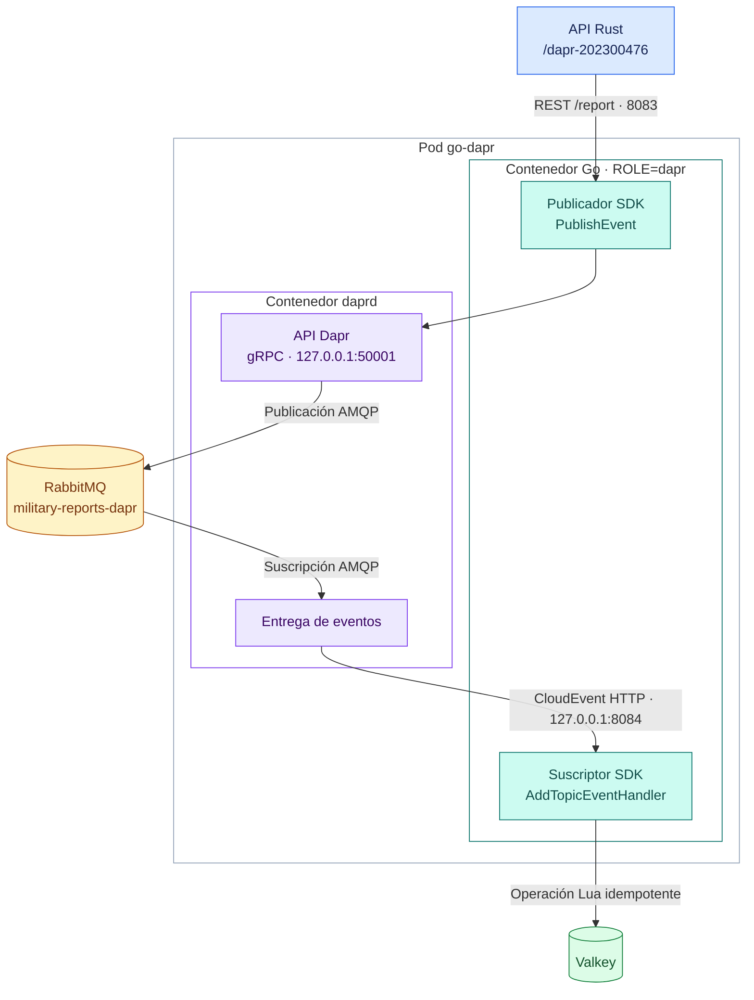

# Flujo opcional con Dapr

La guía del proyecto, página 4, identifica Dapr como puntos extra. El enunciado, página 15, apartado 9.4, pide la ruta alternativa `/dapr-#carnet`. Este perfil implementa `/dapr-202300476` con el SDK oficial de Go y el componente `pubsub.rabbitmq`.

## Recorrido



El Deployment adicional `go-dapr` tiene dos contenedores: el mismo binario Go del proyecto con `ROLE=dapr` y el runtime `daprd`. El publicador y el suscriptor comparten el proceso Go para ahorrar RAM, pero la entrega atraviesa RabbitMQ: el publicador llama `PublishEvent` del SDK; el suscriptor se registra mediante `AddTopicEventHandler`. No invoca directamente el almacenamiento al recibir el POST. El flujo original conserva sus servicios gRPC y su cola `reports`.

Rust aplica exactamente la misma validación, límite de cuerpo e `Idempotency-Key` en ambas rutas. Ambos consumidores usan la misma operación Lua en Valkey. Repetir un identificador por gRPC y Dapr incrementa una sola vez las estadísticas durante 24 horas. Grafana presenta la suma de ambos flujos.

## Perfil de pocos recursos

- Runtime Dapr **1.18.7**, publicado y descargado desde Zot con HTTPS.
- SDK Go **1.13.0**, compatible con Go 1.25 del equipo; los SDK 1.14.2 y 1.15.0 requieren Go 1.26. Se utiliza la API estable de pub/sub, validada contra el runtime instalado.
- Sidecar administrado explícitamente dentro del pod, en modo `standalone`, con componentes montados desde ConfigMap. Es una adaptación para la demostración local; no instala operator, injector, Sentry, Placement, Scheduler ni almacenamiento adicional de Dapr.
- No usa actores, workflows, service invocation entre sidecars ni mTLS de Dapr. Las APIs Dapr y el callback HTTP escuchan en loopback del pod; el Service solo expone el publicador en 8083.
- Un hilo Go por proceso, `GOMEMLIMIT` de 48 MiB para la aplicación y 128 MiB para daprd. Límites de contenedor: 80 y 256 MiB. Estos máximos no representan consumo permanente ni sustituyen las mediciones.
- Métricas y tracing de Dapr desactivados. Se reutilizan el broker, Valkey y el dashboard existentes.

## Configuración y garantías

`deploy/dapr.yaml` contiene los componentes locales y el Deployment. `secretstores.local.env` resuelve únicamente variables con prefijo `SO1_SECRET_`; Kubernetes inyecta la URL AMQP desde `p3-auth`, sin contraseña en el ConfigMap ni en Git. Este secret store es apropiado para el perfil local y no requiere permisos de API Kubernetes en el pod.

El componente utiliza una cola durable, sin auto-delete, mensajes persistentes, confirmación del publicador, ACK manual, prefetch 4 y consumo secuencial. El topic Dapr es independiente de `reports`, de modo que el Consumer AMQP original no recibe sobres CloudEvent.

202 significa que el runtime completó la publicación con confirmación del broker; el suscriptor almacena posteriormente. Si Valkey falla, el handler espera 500 ms, devuelve error y solicita reintento para evitar reentregas en un bucle de CPU. `requeueInFailure:true` permite reentrega; una redelivery que ya se almacenó no altera las estadísticas. Los mensajes inválidos se descartan sin reintento y se registran en logs. Se mantiene la entrega al menos una vez, con deduplicación limitada a 24 horas.

La cola Dapr limita pendientes a 10000 y TTL de 24 horas. El comportamiento predeterminado de RabbitMQ al alcanzar `maxLen` puede retirar los mensajes más antiguos; a diferencia del Writer directo, este componente no configura `reject-publish`. No se promete retención ilimitada ni ausencia de pérdidas ante saturación, expiración o fallo físico. La evaluación debe usar carga moderada y verificar que la cola se drena.

## Uso y pruebas

La instalación normal (`make mirror`, `make build`, `make up`) incluye Dapr. En una instalación ya existente se requieren esos tres pasos para descargar el runtime y actualizar las imágenes de Rust y Go.

```bash
make dapr-test       # carga detenida; pausa/restaura Dapr y Valkey para probar fallos
make compare-flows  # 5 usuarios, 30 s por ruta, mismo perfil y espera
make dapr-off        # libera el pod adicional; la ruta Dapr devuelve 502/503
make dapr-on         # vuelve a habilitarlo sin recompilar
```

`make up` habilita nuevamente todos los componentes, incluido Dapr. `make down` detiene también este flujo y conserva el estado en los PVC existentes.

Para ejecutar solo carga Dapr o abrir Locust con esa ruta:

```bash
SO1_LOAD_PATH=/dapr-202300476 make load USERS=5 DURATION=30s
SO1_LOAD_PATH=/dapr-202300476 make load-ui
```

La interfaz Locust ofrece el selector `report-path` al iniciar una prueba, con las dos rutas públicas. La variable `SO1_LOAD_PATH` define su valor inicial cuando se arranca el proceso; el selector permite cambiar de flujo sin reiniciar el clúster. `compare-flows` usa procesos headless separados y no depende de esa interfaz.

`tests/dapr_e2e.py` verifica publicación real, validación, deduplicación entre rutas, independencia de gRPC al apagar Dapr y reentrega después de una caída temporal de Valkey. Restaura en bloques `finally` los recursos que pausa. Ejecutar sin generadores de tráfico concurrentes para poder comprobar los conteos exactos.

Las comparaciones usan secuencialmente el mismo perfil OCI, usuarios y duración. Comparten hardware y HPA; no aíslan el coste de Dapr ni prueban capacidad máxima. Los resultados y el consumo medido se documentan en [evidencias](evidencias/README.md).

## Referencias oficiales

- [Dapr SDK Go](https://github.com/dapr/go-sdk)
- [Servicio HTTP y suscripciones del SDK](https://docs.dapr.io/developing-applications/sdks/go/go-service/http-service/)
- [Componente pub/sub RabbitMQ](https://docs.dapr.io/reference/components-reference/supported-pubsub/setup-rabbitmq/)
- [Secret store de variables de entorno](https://docs.dapr.io/reference/components-reference/supported-secret-stores/envvar-secret-store/)
- [Dapr self-hosted sin servicios de desarrollo adicionales](https://docs.dapr.io/operations/hosting/self-hosted/self-hosted-no-docker/)
